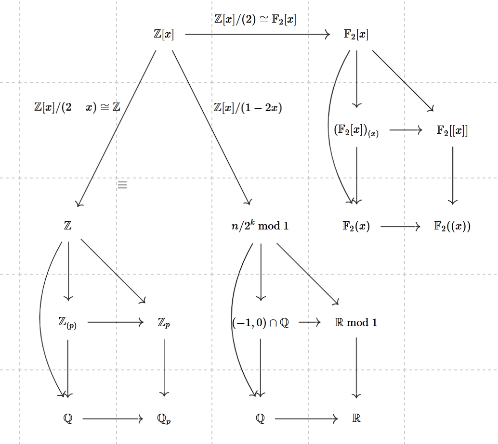

# Algebraic Closure

This page records one diagram and the reading of it in terms of binary strings. The diagram places side by side the rings in which the library's sequences are viewed: $\mathbb{F}_2[x]$ and its completion $\mathbb{F}_2[[x]]$, where an LFSR computes, and $\mathbb{Z}$ and its completion, the 2-adic integers $\mathbb{Z}_2$, where an FCSR computes. The 2-adic side is developed in [2-adic Integers and Rational Sequences](2-adic%20Integers%20and%20Rational%20Sequences.md); the roots of $\overline{\mathbb{F}_2}$ themselves are the subject of [Roots and the Algebraic Closure](Roots%20and%20the%20Algebraic%20Closure.md).

> **OPEN:** Should this page be retitled, or merged into [2-adic Integers and Rational Sequences](2-adic%20Integers%20and%20Rational%20Sequences.md)? — needs author input.
> The page is titled "Algebraic Closure", but nothing on it concerns an algebraic closure: its content is the localizations and completions of $\mathbb{Z}$ and $\mathbb{F}_2[x]$.

## What the Diagram Shows

The diagram starts from $\mathbb{Z}[x]$ at the top left and draws three arrows out of it, each labelled with a quotient:

- a horizontal arrow labelled $\mathbb{Z}[x]/(2) \cong \mathbb{F}_2[x]$, to $\mathbb{F}_2[x]$ at the top right;
- a downward arrow labelled $\mathbb{Z}[x]/(2 - x) \cong \mathbb{Z}$, to $\mathbb{Z}$ on the left;
- a downward arrow labelled $\mathbb{Z}[x]/(1 - 2x)$, to an object in the middle labelled "$n/2^k \bmod 1$".

Only $\mathbb{Z}[x]$ and $\mathbb{F}_2[x]$ sit in the top row; $\mathbb{Z}$ and the middle object sit lower, level with $\mathbb{F}_2(x)$.

Below each of the three targets the diagram draws the same arrangement of arrows among five objects. In the left column these are the ring $\mathbb{Z}$, its localization $\mathbb{Z}_{(p)}$, and its completion $\mathbb{Z}_p$, with $\mathbb{Q}$ and $\mathbb{Q}_p$ underneath. In the right column they are the ring $\mathbb{F}_2[x]$, its localization $(\mathbb{F}_2[x])_{(x)}$, and its completion $\mathbb{F}_2[[x]]$, with $\mathbb{F}_2(x)$ and $\mathbb{F}_2((x))$ underneath. The left column is drawn for a general prime $p$; the case used in this library is $p = 2$.

> **OPEN:** What does the middle column represent? — needs author input.
> The diagram draws $\mathbb{Z}[x]/(1 - 2x)$ mapping to "$n/2^k \bmod 1$", then $(-1, 0) \cap \mathbb{Q}$ and $\mathbb{R} \bmod 1$, with $\mathbb{Q}$ and $\mathbb{R}$ underneath. Nothing in the repository explains these objects or the maps between them.

## Localizing and Then Completing

In each column there are two routes from the ring to its completion: a direct arrow, and a path through the localization. In the left and right columns the two routes give the same ring, in the following sense.

The **completion** of a ring $R$ with respect to an ideal $I$ is the inverse limit of the quotients $R/I^n$. In the left column the ideal is $(p)$, so $\mathbb{Z}_p = \varprojlim \mathbb{Z}/p^n\mathbb{Z}$, and the completion of the localization is $\varprojlim \mathbb{Z}_{(p)}/p^n\mathbb{Z}_{(p)}$. In the right column the ideal is $(x)$.

The two inverse limits agree because the quotients agree at every level: the map

$$\mathbb{Z}/p^n\mathbb{Z} \to \mathbb{Z}_{(p)}/p^n\mathbb{Z}_{(p)}$$

induced by the inclusion $\mathbb{Z} \subset \mathbb{Z}_{(p)}$ is an isomorphism. It is injective because $p^n\mathbb{Z}_{(p)} \cap \mathbb{Z} = p^n\mathbb{Z}$: if an integer $a$ equals $p^n c/d$ with $d$ prime to $p$, then $ad = p^n c$, so $p^n$ divides $a$. It is surjective because any element of $\mathbb{Z}_{(p)}$ is a fraction $a/b$ with $b$ prime to $p$; choosing an integer $b'$ with $bb' \equiv 1 \pmod{p^n}$,

$$\frac{a}{b} - ab' = \frac{a(1 - bb')}{b} \in p^n\mathbb{Z}_{(p)},$$

so $a/b$ has the same class as the integer $ab'$. The same argument, with $x^n$ in place of $p^n$, applies to $(\mathbb{F}_2[x])_{(x)}$ and $\mathbb{F}_2[x]$.

## Reading the Left Column as Strings

A 2-adic integer is a formal sum $\sum_{i \geq 0} s_i 2^i$ with $s_i \in \{0, 1\}$, so every binary sequence $s_0, s_1, s_2, \ldots$ is a 2-adic integer read low bit first (see [The 2-adic integers](2-adic%20Integers%20and%20Rational%20Sequences.md#the-2-adic-integers)). Under this reading, the three rings of the left column, with $p = 2$, are three sets of strings.

- **$\mathbb{Z}$.** These are the eventually constant strings. A non-negative integer has a terminating binary expansion, so its string is eventually 0. A negative integer $n$ is the bitwise complement of $-n - 1$: for any string $y$, adding $y$ to its complement gives $\ldots 1111_2 = -1$, so the complement of $y$ is $-1 - y$, and taking $y = -n - 1 \geq 0$ gives $n$. Its string is therefore eventually 1.
- **The localization $\mathbb{Z}_{(2)}$.** This is the ring of fractions $a/b$ with $b$ odd, and its elements are the eventually periodic strings: a binary sequence is eventually periodic if and only if it is the expansion of a fraction with odd denominator (the proposition of [Which sequences are rational](2-adic%20Integers%20and%20Rational%20Sequences.md#which-sequences-are-rational)).
- **The completion $\mathbb{Z}_2$.** These are all binary strings, periodic or not.

Completing $\mathbb{Z}$ directly extends a string that is eventually constant to one of unrestricted infinite length. Completing after localizing starts instead from eventually periodic strings and lets the period grow without bound. Both descriptions are informal pictures of the same set, the set of all binary strings, in line with the identification above.

In both the localization and the completion, reduction modulo 2 keeps only the first symbol $s_0$ of the string, which is an element of $\mathbb{F}_2$.
