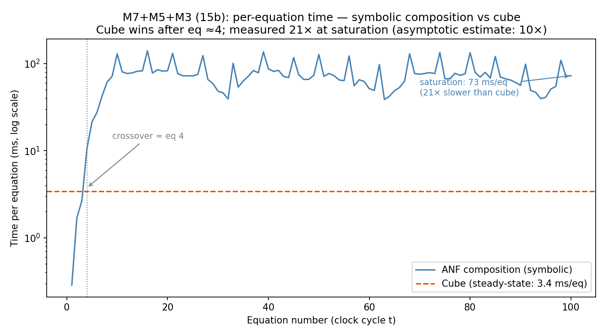
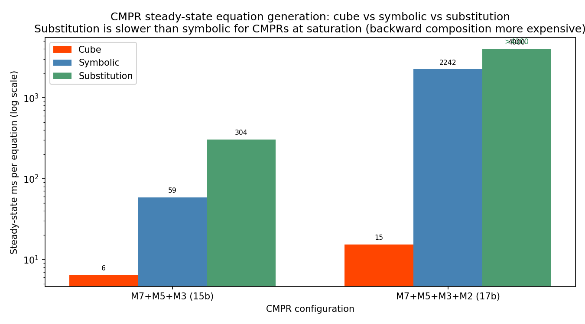
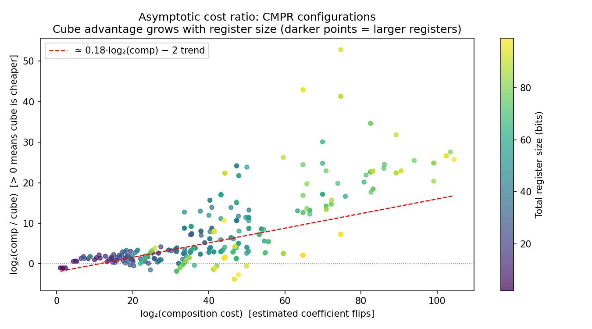
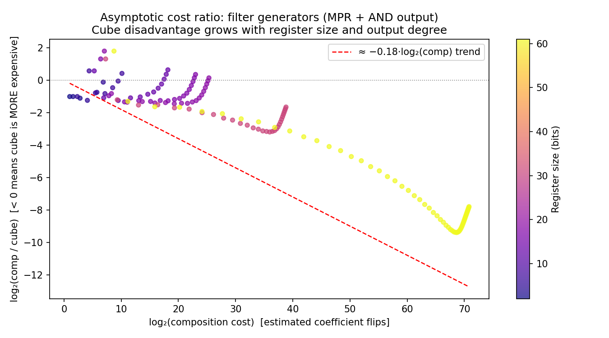
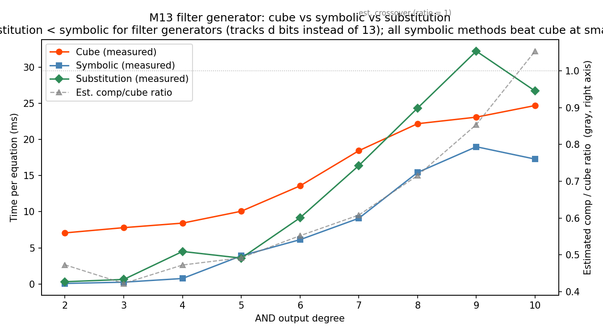
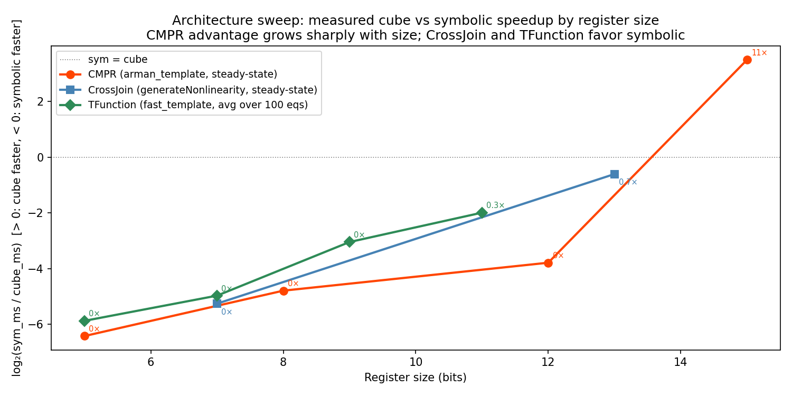
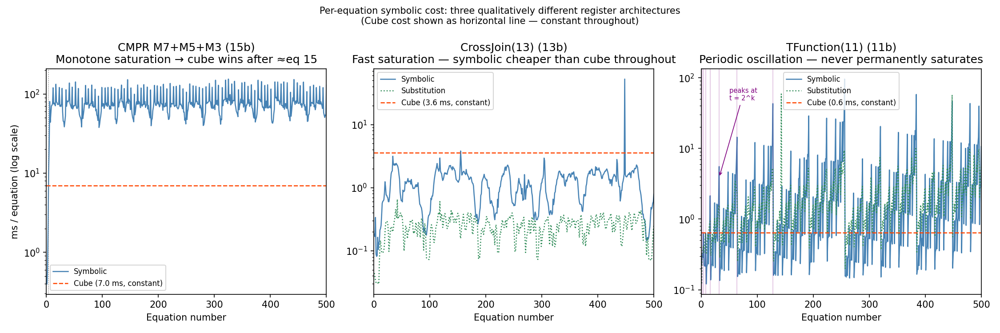
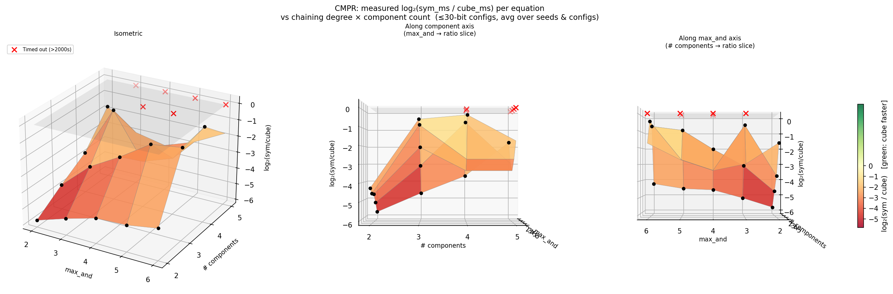
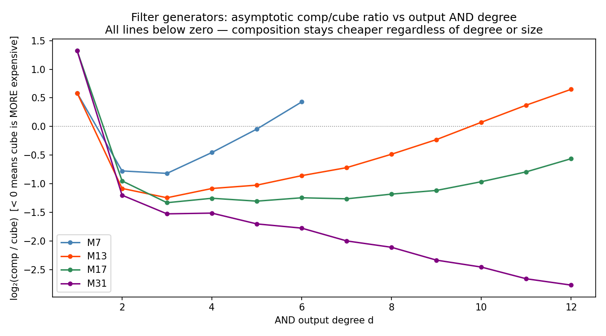

# Cube-Based Equation Generation

An algebraic attack on a feedback register needs a large system of equations in [Algebraic Normal Form](Algebraic%20Normal%20Form.md) (ANF): one equation per observed output bit, expressing that bit as a polynomial over $\mathbb{F}_2$ in the initial-state variables (see [Algebraic Attacks](Algebraic%20Attacks.md)). The direct way to obtain these polynomials is to compose ANFs symbolically through the feedback function tree. This is correct but slow for large CMPRs (composite Mersenne product registers: several MPR blocks joined by nonlinear chaining functions), because the internal ANFs grow to exponential size.

This document describes the cube-based alternative, implemented by `CubeEqGenerator`. It computes the same result, the coefficient of each monomial in the output ANF, by a different route: cube summation over evaluations of the register. Once the symbolic ANFs have reached full size, the measurements below put it ahead of symbolic composition by about 20× in one run and about 6× in another on a 15-bit CMPR (the two runs disagree; see the open question at the first table), and by about 150× on a 17-bit CMPR. The tradeoff is that the method does not produce the ANF as a symbolic object; it produces only the coefficients.

The sections below state the identity the method rests on, derive the three optimizations that make it fast, give a cost model for comparing it with composition, and report measurements showing which register families benefit and which do not.

## Background: The Cube Attack Identity

The starting point is this identity from the cube attack literature. For a polynomial $p(x_1, \ldots, x_n)$ over $\mathbb{F}_2$ and a set of variable indices $I \subseteq \{1, \ldots, n\}$,

$$p(x_1, \ldots, x_n) = T_I \cdot p_{S(I)}(x_1, \ldots, x_n) \oplus Q(x_1, \ldots, x_n)$$

where:
- $T_I = \prod_{i \in I} x_i$ is the monomial over index set $I$
- $p_{S(I)}$ is the **superpoly** of $p$ with respect to $I$ — a polynomial that does not depend on any variables in $I$
- $Q$ is a remainder containing no monomial divisible by $T_I$

Write $v$ for an assignment to the variables in $I$ (the **cube variables**) and $y$ for the remaining, non-cube variables, so that $p = p(v, y)$. A **cube sum** is the XOR of $p$ over all $2^{|I|}$ assignments $v$, with $y$ held fixed. Two observations evaluate it.

- Each monomial of $Q$ omits some variable $x_i$ with $i \in I$, so its value does not depend on $v_i$. Pairing each assignment with the one that differs from it only in $v_i$, the monomial takes the same value on both members of every pair, and its contributions cancel.
- Each monomial of $T_I \cdot p_{S(I)}$ has the form $T_I \cdot \mu(y)$, where $\mu$ is a monomial of the superpoly. Since $T_I(v) = 1$ only at the all-ones assignment, the monomial contributes $\mu(y)$ exactly once.

Hence

$$\bigoplus_{v \in \{0,1\}^{I}} p(v, y) = p_{S(I)}(y),$$

the superpoly evaluated at the non-cube variables. Setting $y = 0$ leaves $p_{S(I)}(0)$, the constant term of the superpoly, and that constant is the coefficient of $T_I$ in $p$.

This gives a direct formula: the coefficient of any monomial $T_I$ in $p$ equals the cube sum of $p$ over $I$ with every non-cube variable fixed at 0. Applied to a register, $p$ is the output function evaluated after $t$ clock cycles, and the variables $x_i$ are the bits of the initial state.

## The Three Optimizations

### Precomputed Evaluations

A cube sum for index set $I$ requires summing $p$ over all $2^{|I|}$ assignments to variables in $I$, with the remaining variables fixed at 0. Many different cube sums share the same evaluation of $p$ at the same initial state. The first optimization is to precompute all needed evaluations and reuse them.

In practice the generator maintains one register for each initial state needed by any cube sum. On each clock cycle it updates all registers in parallel and evaluates the output function on all of them in parallel, filling a vector of evaluations. All cube sums are computed by summing subsets of this precomputed vector.

The library indexes these states by a dictionary called `var_map`, which assigns a row index to each monomial; the state for a monomial has 1 in exactly the positions of the monomial's variables and 0 elsewhere (`CubeEqGenerator` in `src/PyPR/Cryptanalysis/Components/EquationGenerators/CubeEqGenerator.py`). The size of `var_map` is therefore the number of register states maintained, and the measurements below refer to it by that name.

This completely separates running registers from summing coefficients.

### Graded Cube Splitting

If cube sums are computed in **graded order** (degree-1 first, then degree-2, etc.), any degree-$d$ sum can be computed from already-known smaller sums, cutting the cost from $O(2^d)$ to $O(2^{d/2})$ per monomial.

The argument is as follows. Let:
- $V$ be the set of all binary vectors (initial states)
- $V_I \subseteq V$ be the $2^{|I|}$ initial states used for the cube over $I$: every assignment to the variables in $I$, with all other variables fixed at 0
- $F(V') = \bigoplus_{v \in V'} p(v)$ be the XOR-sum of evaluations over a set of states

The key property is that $F$ is linear (over $\mathbb{F}_2$), so:

$$\forall A, B \subseteq V: \quad F(A) \oplus F(B) = F(A \cup B) \oplus F(A \cap B)$$

Now pick any subset $I' \subseteq I$. Consider the collection of subcubes $V_{I \setminus \{i\}}$ for each $i \in I'$ (the cubes that "drop" one variable from $I'$ at a time).

Every vector in $V_I$ that does *not* have all bits in $I'$ set to 1 appears in at least one of these subcubes. The vectors that have all bits in $I'$ set form a remaining set $V_{\text{remaining}}$ of size $2^{|I| - |I'|}$. So:

$$F(V_I) = F\!\left(\bigcup_{i \in I'} V_{I \setminus \{i\}}\right) \oplus F(V_{\text{remaining}})$$

The second term costs $2^{|I| - |I'|}$ to compute directly. For the first term, apply inclusion-exclusion with the identity $V_{I \setminus S_1} \cap V_{I \setminus S_2} = V_{I \setminus (S_1 \cup S_2)}$:

$$F\!\left(\bigcup_{i \in I'} V_{I \setminus \{i\}}\right) = \bigoplus_{S \subseteq I',\, S \neq \emptyset} F(V_{I \setminus S})$$

Since the sums are computed in graded order, every $F(V_{I \setminus S})$ on the right-hand side was already computed (it is a smaller cube sum). There are $2^{|I'|} - 1$ such subsets.

**Total cost** = $(2^{|I'|} - 1) + 2^{|I| - |I'|}$

This is minimized by choosing $|I'| \approx |I|/2$. With $d = |I|$:

$$\text{cost per monomial} = 2^{\lfloor d/2 \rfloor} + 2^{\lceil d/2 \rceil} - 1 = O(2^{d/2})$$

Compared with the naive cost of $2^d$, this is exponentially better in the degree.

### Loop Precomputation and JIT Compilation

Because the same index patterns are reused every clock cycle (the cube structure is fixed), all the indices into the evaluation vector can be precomputed once. The entire coefficient computation then reduces to a deeply nested loop of XOR operations on binary arrays, with no symbolic monomial objects and no data structure overhead.

A loop of this shape is easily parallelized, entirely JIT-compilable (with Numba in this library), and cache-friendly.

## The Coefficient-Flip Cost Model

Both methods' costs are measured in **coefficient flips per ANF generated**. This unit is hardware-agnostic and allows a fair comparison of scaling without the implementation advantage of the cube method distorting the picture. In the tables and plots below, *comp* abbreviates the composition cost and *cube* the cube-based cost, and a *model estimate* is a count in this unit.

### ANF Composition Cost (a Deliberate Underestimate)

To make the comparison as favorable as possible for composition, assume:
- Updating a monomial coefficient costs $O(1)$ (requires a hashmap or similar structure)
- It is possible to iterate over only the monomials that could possibly be nonzero (requires metadata about the ANF's monomial profile)

Neither of these is true in the current library implementation, so this analysis *understates* the true composition cost.

Under these assumptions:
- **Multiplying** two ANFs with monomial counts $|M_1|$ and $|M_2|$: cost $(|M_1| \cdot |M_2|)/2$
- **Adding** two ANFs: cost $\min(|M_1|, |M_2|)$

These are evaluated bottom-up on the binarized function tree using dynamic programming. Each node computes its own monomial profile and cost from its children's profiles. The total is the cost at the root, summed over all feedback functions and the output function.

### Cube-Based Cost

As derived in [Graded Cube Splitting](#graded-cube-splitting), for each output monomial of degree $d$, the cost is:

$$2^{\lfloor d/2 \rfloor} + 2^{\lceil d/2 \rceil} - 1$$

To get the total cost, iterate over all possible degree vectors (one degree per register block) using the degree rollover logic from `MonomialProfile.get_monomials()` (see [Monomial Profile Theory](Monomial%20Profile%20Theory.md) for how profiles bound the monomial set):
- Maintain a vector of current degrees, one per register block.
- Increment one entry at a time; when it exceeds the block's maximum, "roll over" (reset and carry to the next block).
- For each degree vector, multiply the per-monomial cost by the number of monomials with those degrees (binomial coefficients per block, multiplied across independent blocks).

## Practical Comparison

The cost estimators in `CostEstimation.py` implement the two models of the previous section. Because the estimates are deliberately favorable to composition ($O(1)$ coefficient lookup, iterating only over nonzero monomials), any advantage they show for cube is real, not an artifact of assuming a bad composition implementation. This section compares the estimates with measured running times.

Two terms recur. As a CMPR is clocked, the symbolic ANFs of its state bits grow until they reach a maximum size, after which their size is fixed; the ANFs are then said to have **saturated**, and the regime after that point is called **steady state**.

### Measured speedup on CMPRs

The first measurement is for the CMPR with MPR blocks of sizes 7, 5 and 3 (written M7+M5+M3; 15 bits in total), chained with `arman_template`, with the single state bit `VAR(0)` as output:

| Quantity | Value |
|---|---|
| `var_map` size (states maintained by cube) | 3,046 |
| Estimated comp cost | 405,859 coefficient flips |
| Estimated cube cost | 41,792 coefficient flips |
| Estimated ratio (comp/cube) | 9.7× |
| Cube steady-state (measured) | 3.5 ms/eq |
| Symbolic at saturation (measured) | 69 ms/eq |
| Measured speedup | ≈ 20× |

> **OPEN:** Which run is canonical for M7+M5+M3? — needs author input.
> This table gives 3.5 ms/eq for cube and 69 ms/eq for symbolic. The steady-state table below gives 8 ms/eq and 51 ms/eq for the same configuration. In the 17-bit row of that table, 2,335 / 15 is about 156, against the stated 153×.

The measured speedup (20×) exceeds the estimated ratio (9.7×). The difference comes from two compounding factors: (1) the JIT-compiled cube loop processes array XORs far faster than Python's per-object ANF operations, and (2) the composition cost estimate is already favorable, so the true symbolic cost is higher than counted. Both push the measured advantage beyond what the coefficient-flip model predicts.

Dividing the measured speed-up by the model's ratio gives a quotient that contains both factors, so it is an upper bound on the cube generator's advantage per coefficient flip, not a measurement of it: the quotient is that advantage multiplied by the factor (at least 1) by which the model understates the composition cost. For the 15-bit CMPR the quotient is between about 0.7 and about 2 ($6.4 / 9.7$ from the 8 and 51 ms/eq run in the steady-state table below, $20 / 9.7$ from this table); for the 17-bit CMPR in the steady-state table it is about 4 ($153 / 37.9$).

A separate benchmark, in which the cube generator produced 10,000 equations in 5 s and symbolic composition produced 10 equations in 30 s, gave a ratio of about 6,000×.

> **OPEN:** Which register, chaining template and output function produced the 6,000× benchmark? — needs author input.
> Only the equation counts and times above are recorded.

### The crossover

Cube is not *always* faster for CMPRs. In the very early equations ($t \approx 1$–$15$ for a 15-bit register), the symbolic ANFs are still small and Python operations on them run faster than the JIT overhead from managing 3000 register states. The cube method's advantage only appears once the symbolic ANFs saturate.



The plot shows per-equation time (log scale) for both methods as a function of clock cycle. Symbolic starts near 0.5 ms/eq, grows rapidly as the chaining ANFs fill in, and saturates around equation 15 at ~70 ms/eq. Cube is roughly constant at 3.5 ms/eq throughout. For this 15-bit register the crossover occurs near equation 15; an attack on it that needs more equations than that spends the remainder in the regime where cube is faster.

### Steady-state comparison: all three generators

The library provides three equation generators. The table below compares their per-equation times at CMPR steady state.

- **Cube** (`CubeEqGenerator`) has constant cost per equation regardless of clock cycle. The JIT-compiled state array dominates, and the cost is proportional to the size of `var_map`.
- **Symbolic** (`SymbolicEqGenerator`) composes small feedback functions *forward* through the large state. At saturation the state ANFs are fixed in size, so per-equation cost levels off.
- **Substitution** (`SubstitutionEqGenerator`) tracks only the bits used by the output function, but composes the *large* saturated ANF *backward* through all $n$ feedback functions at every step, which is more expensive than forward composition at saturation (326 ms/eq against 51 ms/eq in the first row below). The `SubstitutionEqGenerator` docstring describes it as generally slightly faster than the symbolic generator; that description does not hold for CMPRs at steady state.

| Configuration | Cube | Symbolic | Substitution |
|---|---|---|---|
| M7+M5+M3 (15 bits) | 8 ms/eq | 51 ms/eq | 326 ms/eq |
| M7+M5+M3+M2 (17 bits) | 15 ms/eq | 2,335 ms/eq | >4,000 ms/eq (impractical) |

For the 17-bit configuration the estimated ratio from the coefficient-flip model is 37.9×; the measured cube speedup over symbolic is 153×.



## Dependence on Register Family

The cube method is not faster for every register. Which method is cheaper depends on how the internal ANF complexity compares to the output ANF complexity. This section takes the register families in turn. For the generator taxonomy and how `CubeEqGenerator` fits alongside `SymbolicEqGenerator` and `SubstitutionEqGenerator`, see [Components Architecture](../architecture/Components_Architecture.md) section 4.

**CMPRs:** The cube method is faster at steady state in both measured cases: the speed-up above is about 20× in one run and about 6× in the other at 15 bits (see the open question at the first table), and 153× at 17 bits. The chaining functions make the internal ANFs of a CMPR grow to exponential size over time, as bounded by the [monomial profiles](Monomial%20Profile%20Theory.md). Composition requires multiplying through all those internal ANFs at every clock cycle. The cube method skips all of that: it precomputes a fixed set of register evaluations once and then performs constant-cost cube sums per equation. The per-equation cost is determined entirely by the output's monomial structure, not the internal complexity.

The plot below sweeps all CMPR configurations whose component sizes are drawn from 2, 3, 5, 7, 13, 17, 19, 31 and 61, over total register sizes up to 100 bits. The chaining is generated by `fast_template`, in which each block's chaining function draws its inputs from the union of all upstream blocks, with `max_and=4`, the maximum number of variables in an AND term of a chaining function. Each point is one configuration; color encodes total register size. The $y$-axis is $\log_2(\text{comp}/\text{cube})$, so positive means cube is cheaper. The dashed line is a linear fit in these log-log coordinates. A linear relation there means that the ratio comp/cube grows as a power of the composition cost.

> **OPEN:** What are the slope and intercept of the fitted line? — needs author input.
> The exponent of the power law is the slope; neither value is recorded in this document.



**Filter generators** (simple MPR + nonlinear output function): The cube method is more expensive than composition, both in the coefficient-flip model and in measurement. The internal state update for an MPR is linear: each state bit at time $t$ is a linear combination (XOR) of the $n$ initial state bits, and this never changes. So the symbolic ANFs for individual state bits stay at degree 1 forever. Composing a degree-$d$ AND output through these linear functions is cheap: it involves multiplying $d$ linear polynomials, with a result that has at most $\binom{n}{d}$ monomials. The cube method, by contrast, must maintain one register state per entry in `var_map`, which for an AND of degree $d$ on $n$ variables grows as $\sum_{k \leq d}\binom{n}{k}$ (sized via the output function's [root expression](Root%20Expressions%20and%20LC%20Estimation.md)), an exponential in $d$. The cost of updating that state array per equation grows linearly with the size of `var_map`.

The model-estimate plot below sweeps each MPR of the sizes listed above against AND-output degrees from 1 up to the register size. Points cluster below the zero line, meaning cube is more expensive, and the gap widens as comp cost grows, which is the opposite of the CMPR trend.



The measured benchmark below confirms this for M13 (the 13-bit MPR) at AND degrees 2–10. Symbolic stays faster at every degree. The estimated comp/cube ratio (green, right axis) crosses 1.0 near degree 10, predicting that cube should *start* to become competitive there. The measured data shows symbolic is still ~1.5× faster even at degree 10, because the JIT overhead from maintaining 8,100 register states is a large constant that the coefficient-flip model does not capture. A genuine measured crossover in favor of cube would require a much larger MPR ($n \approx 31+$) at high degree, where the symbolic polynomial products finally become more expensive than the JIT state-array overhead.



**T-functions (triangular feedback, binary-counter base):** Neither method is faster at every size. A T-function has $n$ single-bit blocks, one per bit, so `var_map` grows exponentially with size (an 11-bit T-function needs 1025 states). Unlike a CMPR, the output ANF never permanently saturates: per-equation symbolic cost oscillates, peaking at every power-of-2 clock cycle as the carry chain reaches maximum depth. The peaks grow: the peak at $t = 2^k$ is larger than the peak at $t = 2^{k-1}$. The correct characterization is the average over many equations spanning multiple oscillation cycles. For small T-functions ($n \le 9$), symbolic is faster on average because the oscillation peaks are modest relative to the cube state-array overhead. For larger T-functions the peaks grow, and the measurements here do not settle which method is faster on average.

**CrossJoin registers (single block, paired AND terms):** The entire register is one monomial-profile block, so `var_map` stays small (~14 states for a 13-bit CrossJoin). Symbolic saturates within the first 20 equations and then costs only a few ms/eq. Cube incurs JIT state-array overhead on top of its intrinsically low per-equation cost, but `var_map` is so small that the overhead is not amortized. Symbolic is faster throughout.

The plot below shows measured $\log_2(\text{sym}/\text{cube})$ vs register size for all three architecture families. Positive $y$ means cube is faster; negative means symbolic is faster. CMPR grows rapidly with size (symbolic saturates to exponential ANFs); CrossJoin and TFunction stay negative or near zero (small `var_map`, non-saturating or cheap symbolic cost).



The per-equation trace below shows these three qualitatively different shapes side by side: CMPR's monotone saturation, CrossJoin's fast flat plateau, and TFunction's periodic oscillation with growing power-of-2 peaks.



### How chaining degree affects the CMPR advantage

The model estimate of cube's advantage over composition for a CMPR grows with the `max_and` chaining parameter. Higher `max_and` means more variables per AND gate in the chaining template, which drives internal ANFs to larger polynomials and makes composition proportionally more expensive. The cube cost, determined only by the output's monomial profile, increases more slowly.



### How output AND degree affects the filter-generator disadvantage

For filter generators (linear MPR + AND output), the degree sweep below shows that composition remains cheaper than cube across all tested degrees and register sizes. Lines stay below $y = 0$ throughout; the gap widens as degree grows.



### Summary

If the internal ANF growth is the bottleneck (large feedback functions, many components, deep chaining), the cube method is faster at steady state. If the internal state update is linear (no chaining), or if only a small number of equations is needed (before the symbolic ANFs saturate), composition is faster.

## API

The two cost models are exposed in `PyPR.Tools.CostEstimation`. In the example, `C` is a feedback function and `output_fn` a Boolean function:

```python
from PyPR.Tools.CostEstimation import estimate_cost_comp, estimate_cost_cube

mps = C.monomial_profiles()
comp = estimate_cost_comp(C, output_fn, mps)
cube = estimate_cost_cube(C, output_fn, mps)
```

- `estimate_cost_comp(feedback_fn, output_fn, monomial_profiles)` — estimates composition cost in coefficient flips, walking the binarized function tree bottom-up.
- `estimate_cost_cube(feedback_fn, output_fn, monomial_profiles)` — estimates cube-based cost using the graded-split formula, iterating over all degree vectors via rollover logic.
- Both accept any `FeedbackFunction` (not just CMPR) and any `BooleanFunction` as output.
- `monomial_profiles` is the list returned by `C.monomial_profiles()` — one `MonomialProfile` per register bit.
