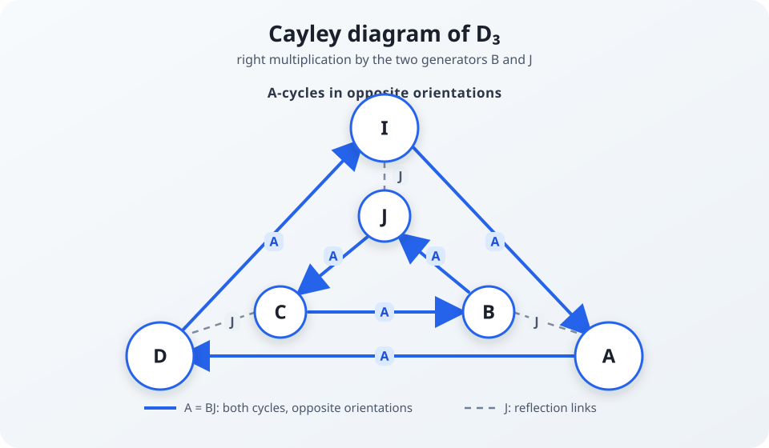

# Dihedral Symmetries of the Boolean Transform

The [Algebraic Normal Form](Algebraic%20Normal%20Form.md) of a Boolean function is computed from its truth table by the Möbius transform, which is the Kronecker power of a single $2 \times 2$ matrix over $\mathbb{F}_2$: [the one-bit matrix](Algebraic%20Normal%20Form.md#the-one-bit-matrix), written $T_1$ in that document and $\mathsf B$ here. This document describes the group generated by that matrix together with the matrix $J$ that exchanges the two coordinates. The group consists of six $2 \times 2$ matrices over $\mathbb{F}_2$ and is isomorphic to the **dihedral group of order 6** ($D_3 \cong S_3$). The sections below list the six matrices and the relations among them, describe the action of each on a vector indexed by bit masks, and relate those actions to the conventions of the [Division Property](Division%20Property.md).

The document assumes the ANF and the bit-subset order $\preccurlyeq$, where $i \preccurlyeq n$ means that every bit set in $i$ is also set in $n$; both are developed in [Algebraic Normal Form](Algebraic%20Normal%20Form.md) and [Möbius Inversion on the Bit-Subset Lattice](Moebius%20Inversion%20on%20the%20Bit-Subset%20Lattice.md).

All matrices act on column vectors by left multiplication. Their displayed rows and columns use the NumPy-style convention in [Matrix Indexing](../conventions/Matrix%20Indexing.md); in particular, row 0 is the top row and coordinate 0 is the top entry of the vector.

## The Six Matrices

The group is generated by the one-bit Möbius transform and the **antidiagonal** (exchange) matrix

$$
J = \begin{pmatrix} 0 & 1 \\ 1 & 0 \end{pmatrix}.
$$

We name the four matrices with exactly one zero by the location of that zero, in row-major order:

$$
\mathsf A = \begin{pmatrix}0&1\\1&1\end{pmatrix},\quad
\mathsf B = \begin{pmatrix}1&0\\1&1\end{pmatrix},\quad
\mathsf C = \begin{pmatrix}1&1\\0&1\end{pmatrix},\quad
\mathsf D = \begin{pmatrix}1&1\\1&0\end{pmatrix}.
$$

Thus $\mathsf B$ is the one-bit Möbius transform. Each base matrix lifts to arbitrary scale by

$$
\mathsf X_m = \mathsf X^{\otimes m}\qquad (\mathsf X\in\{\mathsf A,\mathsf B,\mathsf C,\mathsf D\}),
$$

with $J_m=J^{\otimes m}$ and $\mathsf I_m=I^{\otimes m}$. The subscript is the scale, so $\mathsf A_3$ is an $8\times8$ matrix.

The six elements of the group are the identity, $J$, and the four named matrices. The table lists them at scale $m$ with their orders; the roles in the last column are defined in [The Antidiagonal and Set Complementation](#the-antidiagonal-and-set-complementation) and [The Four Basic Operations](#the-four-basic-operations).

| Matrix | Form | Order | Role at scale $m$ |
|--------|------|-------|--------------------|
| $\mathsf I_m$ | $I^{\otimes m}$ | 1 | identity |
| $\mathsf B_m$ | $\begin{pmatrix}1&0\\1&1\end{pmatrix}^{\otimes m}$ | 2 | downward zeta; ANF $\leftrightarrow$ truth table ([Möbius transform](Moebius%20Inversion%20on%20the%20Bit-Subset%20Lattice.md)) |
| $\mathsf C_m$ | $\begin{pmatrix}1&1\\0&1\end{pmatrix}^{\otimes m}$ | 2 | upward zeta (superset sum) |
| $J_m$ | $\begin{pmatrix}0&1\\1&0\end{pmatrix}^{\otimes m}$ | 2 | complement / set inversion |
| $\mathsf D_m$ | $\begin{pmatrix}1&1\\1&0\end{pmatrix}^{\otimes m}$ | 3 | order-3 composition $J\mathsf B$ |
| $\mathsf A_m$ | $\begin{pmatrix}0&1\\1&1\end{pmatrix}^{\otimes m}$ | 3 | order-3 composition $\mathsf B J$ |

The matrix $\mathsf C$ is both the transpose of $\mathsf B$ and its conjugate by $J$: $\mathsf C=\mathsf B^{\top}=J\mathsf B J$.

The generators satisfy

$$
\mathsf B^2=J^2=(J\mathsf B)^3=\mathsf I.
$$

The first two relations are direct squarings. For the third, $J\mathsf B=\begin{pmatrix}1&1\\1&0\end{pmatrix}=\mathsf D$, then $\mathsf D^2=\begin{pmatrix}0&1\\1&1\end{pmatrix}=\mathsf A$, and $\mathsf D^3=\mathsf D\mathsf A=\mathsf I$. These are the defining relations of $D_3=\langle s,t \mid s^2=t^2=(st)^3=1\rangle$ under $s=J$ and $t=\mathsf B$, so $s\mapsto J$, $t\mapsto\mathsf B$ defines a homomorphism from $D_3$ onto the group generated by $J$ and $\mathsf B$. Both groups have six elements, so it is an isomorphism. The two order-3 elements are the products $J\mathsf B=\mathsf D$ and $\mathsf B J=\mathsf A=\mathsf D^{-1}$.

## Cayley Diagram

The diagram groups the six vertices into two nested cycles. Each solid directed edge is right multiplication by $\mathsf A=\mathsf B J$, while each dashed edge is right multiplication by $J$.

The outer cycle is $\mathsf I\to\mathsf A\to\mathsf D\to\mathsf I$; the inner cycle is $J\to\mathsf C\to\mathsf B\to J$. Both use right multiplication by $\mathsf A=\mathsf B J$, but they circulate in opposite visual directions. The three connecting edges are the involution $J$.

The vertex identifications are

$$
\mathsf A=\mathsf BJ,\qquad
\mathsf C=J\mathsf BJ,\qquad
\mathsf D=J\mathsf B,
$$

and the same diagram holds at every scale after replacing each vertex by its subscripted lift.

## The Antidiagonal and Set Complementation

At scale $m$, the Kronecker power $J^{\otimes m}$ is the $2^m \times 2^m$ antidiagonal identity — the permutation matrix that maps index $i$ to its bitwise complement $\bar{i} = (2^m - 1) - i$. When the indices are ordered naturally (so that index $i$ corresponds to the monomial selecting bit-set $\text{bits}(i)$), applying $J^{\otimes m}$ replaces every monomial's variable set $S$ with its complement $\{0,\ldots,m-1\} \setminus S$. This uses the column-vector and integer-index conventions stated above.

What $J_m$ does to a Boolean function depends on which vector it is applied to. On a truth-table vector $f$ it gives $(J_m f)(n)=f(\bar n)$: the function is evaluated at the complemented input. On an ANF coefficient vector it replaces each monomial $x^S$ by $x^{S^{\mathsf c}}$, which is in general a different function from $n\mapsto f(\bar n)$.

> **OPEN:** What is the "absence" description of a Boolean function, as a formula? — needs author input.
> The later sections of this document speak of "presence" and "absence" descriptions and masks (which variables must be 1 versus which must be 0), and of $J_m$ as converting between them, without defining either. Established so far: the two actions of $J_m$ stated above.

## Connection to the Division Property

The [Division Property](Division%20Property.md) is a support-level abstraction for algebraic propagation. For a Boolean function of $m$ variables, it records which input-variable masks can survive in a chosen collection of moments. This section uses masks to index the monomials of an ANF instead.

> **OPEN:** In what sense are the moment masks of a division property equivalent to the possible monomial masks of an ANF? — needs author input.
> The rest of this section treats the two as interchangeable, but the identification is not stated. [Division Property](Division%20Property.md) relates moments to input-set parities by $\mathsf C_m$ and ANF coefficients to truth values by $\mathsf B_m$, but does not identify the two.

A mask is an integer $i$ whose set bits identify a variable set $S=\operatorname{bits}(i)$. The corresponding monomial is

$$
\mu_i(x)=\prod_{b\in S}x_b.
$$

The important distinction is that a division property normally stores a set of possible masks, not the exact coefficient $a_i\in\mathbb F_2$ of every monomial. It therefore tracks possibility and can deliberately forget cancellations. The matrices in this document act exactly on coefficient or value vectors; applying the same matrices to a division-property set requires taking an overapproximation of the resulting support.

### The Four Basic Operations

Let $v=(v_0,\ldots,v_{2^m-1})^{\mathsf T}$ be a vector indexed by masks. Under the matrix convention of this document:

- $\mathsf B_m$ performs the downward zeta sum,
  $$
  (\mathsf B_m v)_n=\bigoplus_{i\preccurlyeq n}v_i.
  $$
  It aggregates contributions from submasks into the mask $n$. In ANF language this is evaluation: coefficient data $a$ becomes truth-table data $f$.
- $\mathsf C_m$ performs the upward zeta sum,
  $$
  (\mathsf C_m v)_n=\bigoplus_{n\preccurlyeq i}v_i.
  $$
  It aggregates contributions from supermasks into $n$, and $\mathsf C_m=\mathsf B_m^{\top}$.
- $J_m$ complements a mask,
  $$
  (J_m v)_n=v_{\bar n},\qquad \bar n=(2^m-1)-n.
  $$
  At the support level, it replaces every mask $S$ by its complement $S^{\mathsf c}$.
- $\mathsf I_m$ leaves the mask vector unchanged.

The zeta transforms are self-inverse over $\mathbb F_2$:

$$
\mathsf B_m^2=\mathsf C_m^2=\mathsf I_m.
$$

This is why the same matrix can describe both directions of the ANF/truth-table conversion. The distinction is which vector is being interpreted as input data and which as output data.

### The Six Dihedral Operations

Matrix multiplication acts from right to left on column vectors, so the factor on the right is applied first:

$$
\begin{array}{c|c|l}
\text{operation} & \text{factorization} & \text{support-level reading}\\
\hline
\mathsf I_m & \mathsf I_m & \text{leave masks unchanged}\\
\mathsf B_m & \mathsf B_m & \text{downward zeta propagation}\\
\mathsf C_m & J_m\mathsf B_mJ_m & \text{upward zeta propagation}\\
J_m & J_m & \text{complement masks}\\
\mathsf A_m & \mathsf B_mJ_m & \text{complement, then downward zeta}\\
\mathsf D_m & J_m\mathsf B_m & \text{downward zeta, then complement}
\end{array}
$$

These are not six independent cryptanalytic rules. They are the six exact compositions generated by one zeta transform and mask complementation. In a division-property calculation, one can choose the orientation that matches the direction of propagation being represented: use $\mathsf B_m$ for submask accumulation, $\mathsf C_m$ for supermask accumulation, and insert $J_m$ when the convention describes absence masks rather than presence masks.

The [Cayley diagram](#cayley-diagram) makes the two order-3 compositions visible. Since $\mathsf A_m=\mathsf B_mJ_m$ and $\mathsf D_m=J_m\mathsf B_m$, they have the same algebraic ingredients but apply them in opposite orders. The two orders give distinct matrices that are inverse to each other: $\mathsf A_m\mathsf D_m=\mathsf B_mJ_mJ_m\mathsf B_m=\mathsf I_m$, while $\mathsf A_m\neq\mathsf D_m$ (the top-left entry is 0 in $\mathsf A_m$ and 1 in $\mathsf D_m$). Reversing the order of complementing and zeta propagation therefore changes the result.

### What This Does and Does Not Prove

For an exact vector of coefficients or values, the identities above are equalities over $\mathbb F_2$. For a division-property set $\mathcal S$, however, the transformed set is generally only bounded by the union of masks reachable from $\mathcal S$. Two different monomials may contribute to the same output coefficient and cancel, while a support-only representation cannot see that cancellation. Therefore:

1. The six matrices provide a precise dictionary between presence/absence, forward/reverse, and subset/superset descriptions.
2. They do not by themselves give the complete nonlinear propagation rule for a cipher. AND layers, linear mixing layers, constants, and chosen- versus known-input conventions still need their own division-property rules.
3. Any claim that a transformed mask is possible should be read as an upper-bound statement unless coefficient information is retained.

This supplies the convention bridge between the Boolean transform and division-property notation without identifying the two theories. The transform group governs changes of representation and ordering; the division property adds a sound support abstraction on top of those representations.

## Connections

- **[Algebraic Normal Form](Algebraic%20Normal%20Form.md):** The Kronecker product structure that these symmetries act on.
- **[Matrix Indexing](../conventions/Matrix%20Indexing.md):** The row, column, vector, and bit-index conventions used here.
- **[Möbius Inversion on the Bit-Subset Lattice](Moebius%20Inversion%20on%20the%20Bit-Subset%20Lattice.md):** $\mathsf B_m$ is the Möbius transform; the group is generated by it together with $J_m$.
- **[Division Property](Division%20Property.md):** The definition of the division property, and the vectors (input-set parities, monomial moments, ANF coefficients, truth-table values) on which $\mathsf B_m$, $\mathsf C_m$ and $J_m$ act there.
